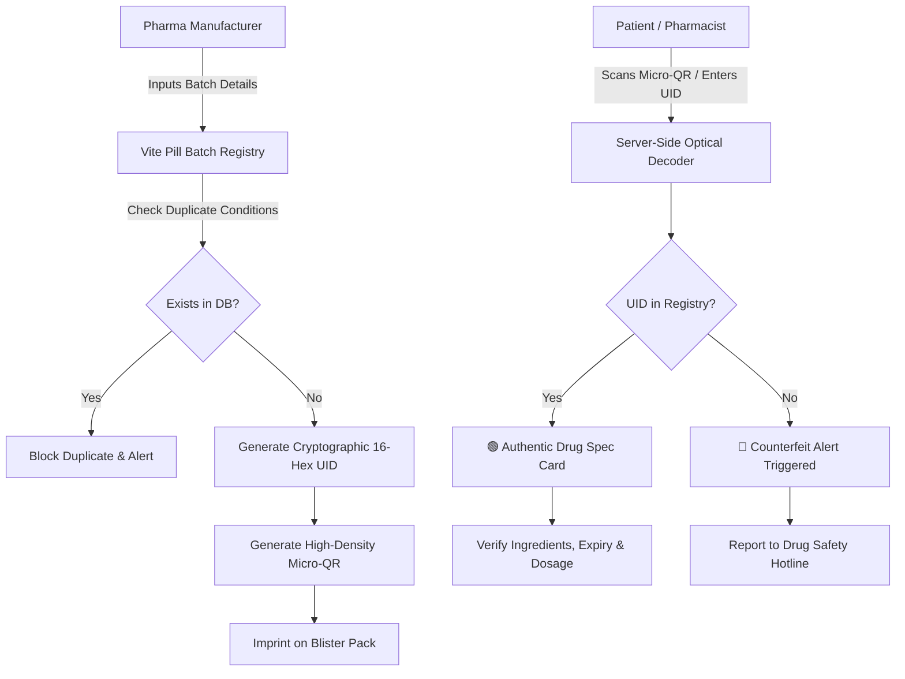

<div align="center">

# 💊 Vite Pill

### _Cryptographic Unit-Level Drug Serialization & Anti-Counterfeit Verification System_

[](https://python.org)
[](https://flask.palletsprojects.com/)
[-yellow?style=for-the-badge&logo=html5&logoColor=white)](#-the-zero-javascript-architecture)
[](#-database-configuration)
[](https://render.com/deploy?repo=https://github.com/SenpaiMudit/Vite-Pill)
[](vite-pill.apk)
[](LICENSE)

**Vite Pill** is an anti-counterfeit pharmaceutical verification web application designed to combat fake medications across the global supply chain using unit-level micro-QR serialization and a strict **100% Zero-JavaScript** architecture accessible on any device.

</div>

---

## 📌 Table of Contents

- [The Problem We Solve](#-the-problem-we-solve)
- [How It Works](#-how-it-works)
- [⚡ The Zero-JavaScript Architecture](#-the-zero-javascript-architecture)
- [📐 System Flow & Verification Logic](#-system-flow--verification-logic)
- [🚀 Hosting on Render (1-Click & Manual)](#-hosting-on-render-1-click--manual)
- [🗄️ Database Configuration](#️-database-configuration)
- [💻 Local Development & Installation](#-local-development--installation)
- [📱 Android Field App (APK)](#-android-field-app-apk)
- [🗂️ Project Structure](#️-project-structure)
- [📄 License & Author](#-license--author)

---

## 🌍 The Problem We Solve

According to the **World Health Organization (WHO)**:
* Over **1,000,000 deaths occur every year** due to counterfeit and substandard pharmaceuticals.
* In developing nations, **1 in 10 medical products** is substandard or falsified.
* Traditional barcodes only track shipping pallets or warehouse boxes — once individual blister packs reach retail pharmacies or rural clinics, patients have zero way to verify authenticity.

Criminal networks exploit this gap by refilling discarded authentic packaging with contaminated or inert substances (such as chalk, flour, or toxic industrial fillers).

**Vite Pill solves this at the individual package level.** By imprinting unique cryptographic micro-QR codes directly onto blister pockets and medicine bottles, each unit carries an unforgeable digital identity linked directly to verified manufacturer production records.

---

## 💡 How It Works

Vite Pill operates across three distinct roles:

1. **Consumer & Patient Verification (`/scan`, `/verify/<uid>`)**:
   - Anyone can snap a photo of the code or enter the 16-character serial code directly.
   - The server instantly validates the serial against the verified pharmaceutical registry:
     - 🟢 **Genuine**: Displays medication name, dosage (mg), active ingredients, indications, manufacturing batch, and expiry status.
     - 🔴 **Counterfeit Alert**: Triggers a high-contrast emergency warning advising the patient not to ingest the medication, alongside direct toll-free reporting hotlines.

2. **Pharmaceutical Manufacturer Portal (`/add`, `/manufacturer/dashboard`)**:
   - Authorized manufacturers securely register production batches with manufacturing/expiry dates, chemical composition, and dosage.
   - Built-in duplicate detection blocks fraudulent attempts to re-register existing batch identifiers.
   - Automatically generates high-density micro-QR image matrices ready for packaging printing.

3. **Master Health Authority (`/admin/users`)**:
   - Dedicated portal for health inspectors and regulatory administrators.
   - Manages and audits manufacturer credentials to ensure unauthorized counterfeiters cannot register fake accounts.

---

## ⚡ The Zero-JavaScript Architecture

**Vite Pill runs with 0% client-side JavaScript.** There are zero `<script>` tags and zero inline event handlers.

### Why Zero JavaScript?

| Advantage | Traditional JS Web App | Vite Pill Zero-JS Architecture |
|---|---|---|
| **Client-Side Exploits** | Vulnerable to script injection (XSS) & extension tampering | **Zero** — no client script execution possible |
| **Device Compatibility** | Often crashes on low-end phones or hospital terminals | **100% universal** — works on any modern or legacy browser |
| **Payload & Speed** | Heavy megabyte bundles, slow parser startup | **Sub-100ms** paint, minimal payload |
| **Bandwidth Efficiency** | Requires multiple network round-trips for JS frameworks | Instant server-rendered HTML forms |

### Pure CSS Interactions:
* **Mobile Drawer Navigation**: Accessible CSS checkbox toggle hack (`input.nav-checkbox:checked ~ nav`).
* **Interactive Previews**: CSS radio states (`input.sim-radio:checked`).
* **Accessible Typography**: High-contrast clinical palette, thumb-friendly tap targets (minimum 52px height).

---

## 📐 System Flow & Verification Logic



---

## 🚀 Hosting on Render (1-Click & Manual)

This repository includes a pre-configured [`render.yaml`](render.yaml) Blueprint that automatically provisions both the **Web Service** and a **Render Managed PostgreSQL** database.

### Option A: 1-Click Blueprint Deployment (Fastest)

1. Fork or push this repository to your GitHub account: `https://github.com/SenpaiMudit/Vite-Pill`.
2. Log in to [Render](https://render.com).
3. Click **New +** → **Blueprint**.
4. Connect this repository and click **Apply**.
5. Render will automatically:
   - Provision a managed PostgreSQL database (`vite-pill-db`).
   - Create the Python web service.
   - Inject the internal `DATABASE_URL` and generate a secure `SECRET_KEY`.
   - Run database schema initialization and seed the master admin account (`admin` / `admin123`).

[](https://render.com/deploy?repo=https://github.com/SenpaiMudit/Vite-Pill)

---

### Option B: Manual Web Service & Database Setup

If you prefer to configure resources manually in the Render Dashboard:

1. **Create Managed Database**:
   - Go to **New +** → **PostgreSQL**.
   - Name: `vite-pill-db`, Database: `vite_pill`, Plan: **Free**.
   - Copy the **Internal Database URL**.

2. **Create Web Service**:
   - Go to **New +** → **Web Service** and select this GitHub repository.
   - **Runtime**: `Python`
   - **Build Command**: `pip install -r requirements.txt`
   - **Start Command**: `gunicorn wsgi:app`
   - **Plan**: Free

3. **Configure Environment Variables**:
   Add the following in the Web Service **Environment** tab:

   | Variable | Value | Notes |
   |---|---|---|
   | `DATABASE_URL` | `<Internal Database URL>` | From your Render PostgreSQL instance |
   | `SECRET_KEY` | `<Random 32-character string>` | Protects session cookies |
   | `PYTHON_VERSION` | `3.11.9` | Recommended Python version |

---

## 🗄️ Database Configuration

Vite Pill includes a multi-engine database adapter ([`vite_pill/db.py`](vite_pill/db.py)) with automatic driver selection:

* **PostgreSQL (Render Managed)**: Activated automatically when `DATABASE_URL` is set. Standardizes `postgres://` to `postgresql://` and uses `psycopg2-binary` with dictionary row mappings.
* **SQLite (Local Fallback)**: Automatically used if `DATABASE_URL` is absent. Creates `database.db` locally for zero-configuration development.

---

## 💻 Local Development & Installation

### 1. Clone the Repository
```bash
git clone https://github.com/SenpaiMudit/Vite-Pill.git
cd Vite-Pill
```

### 2. Set Up Virtual Environment
```bash
python -m venv venv

# Windows (PowerShell):
.\venv\Scripts\Activate.ps1

# Linux / macOS:
source venv/bin/activate
```

### 3. Install Dependencies
```bash
pip install -r requirements.txt
```

> **Note on QR Image Decoding (Pyzbar)**:
> - On **Windows**, `pyzbar` includes bundled DLLs.
> - On **Linux (Ubuntu/Debian)**: `sudo apt-get install -y libzbar0`
> - If `pyzbar` is not present, manual UID lookup (`/scan?manual_uid=...`) continues to work without interruption.

### 4. Run the Local Server
```bash
python wsgi.py
```
Open **`http://127.0.0.1:5000`** in your browser.

---

## 📱 Android Field App (APK)

For field drug inspectors, rural dispensaries, and border control officers, Vite Pill provides a standalone Android APK:

* **File**: [`vite-pill.apk`](vite-pill.apk) (753 KB)
* **Direct Download Route**: `https://your-domain/vite-pill.apk` or `https://your-domain/download/apk`
* **Compatibility**: Android 8.0+
* **Functionality**: Optical camera micro-QR scanner with zero external tracking libraries.

---

## 🗂️ Project Structure

```
Vite-Pill/
├── index.html                  # Zero-JS High-Converting Marketing Landing Page
├── logo.svg                    # Official Vite Pill Brand Vector
├── vite-pill.apk               # Android Mobile Verification Application (753 KB)
├── requirements.txt            # Production Dependencies (Flask, psycopg2, Pillow, etc.)
├── Procfile                    # Render / Gunicorn Procfile
├── render.yaml                 # Render Blueprint Specification (Web Service + PostgreSQL)
├── wsgi.py                     # Root WSGI Application Entrypoint
├── PRODUCT.md                  # Comprehensive Product & Anti-Fraud Specifications
├── DESIGN.md                   # Clinical Design System & Typography Guidelines
├── LICENSE                     # MIT Open Source License
└── vite_pill/                  # Core Application Package
    ├── app.py                  # Zero-JS Routes, Authentication, Verification Engine
    ├── db.py                   # Multi-Engine DB Adapter (PostgreSQL, SQLite)
    ├── database.db             # Local SQLite database (development only)
    ├── requirements.txt        # Package-level requirements
    ├── Procfile                # Package-level Procfile
    ├── static/
    │   ├── logo.svg            # Official Brand SVG
    │   ├── vite-pill.apk       # Static APK copy for direct download
    │   ├── css/
    │   │   └── style.css       # Zero-JS Clinical Design System
    │   └── qrcodes/            # Generated Cryptographic Micro-QR Assets
    └── templates/
        ├── base.html           # Layout with Pure CSS Navigation, Header, Footer
        ├── index.html          # Public Medicine Verification Hub
        ├── scan_medicine.html  # Optical Camera Scan & Manual UID Ingestion
        ├── add_medicine.html   # Manufacturer Batch Registry & QR Generator
        ├── result.html         # High-Visibility Genuine vs Counterfeit Card
        ├── login.html          # Medicine Company Sign In
        ├── admin_login.html    # Master Admin Authentication
        ├── admin_users.html    # Company Provisioning & Batch Audit Logs
        └── 404.html            # Custom Zero-JS 404 Error Page
```

---

## 📄 License & Author

Distributed under the **MIT License**. See [`LICENSE`](LICENSE) for details.

* **Author**: [Mudit Misra (@SenpaiMudit)](https://github.com/SenpaiMudit)
* **Toll-Free Safety Hotline**: [+1 (800) 555-0199](tel:+18005550199)
* **Official Inquiries**: [verify@vitepill.io](mailto:verify@vitepill.io)
* **GitHub Repository**: [https://github.com/SenpaiMudit/Vite-Pill](https://github.com/SenpaiMudit/Vite-Pill)
